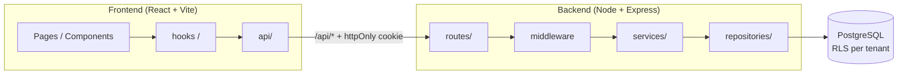
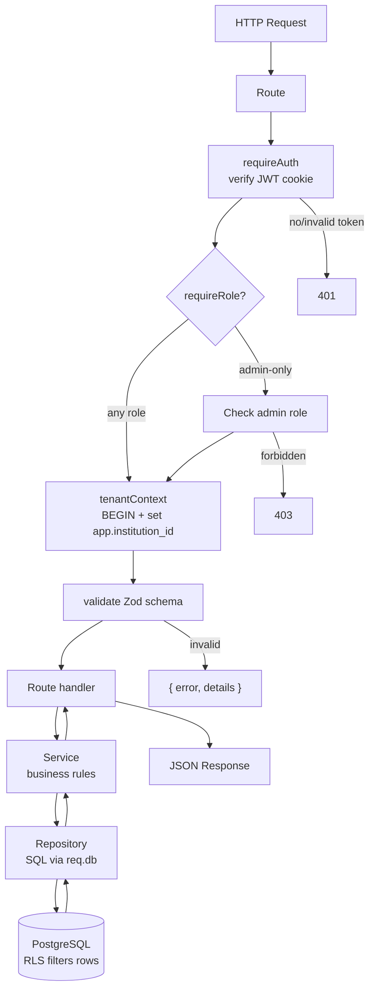
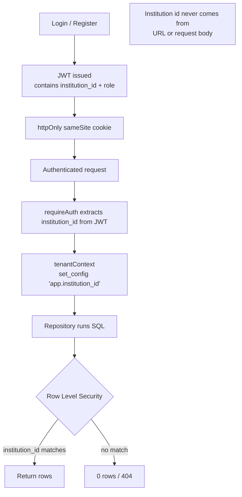
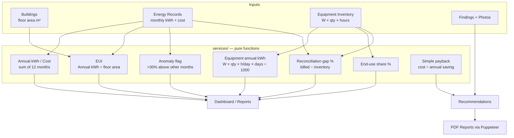
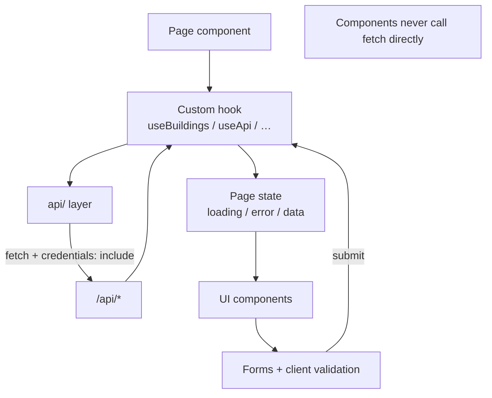
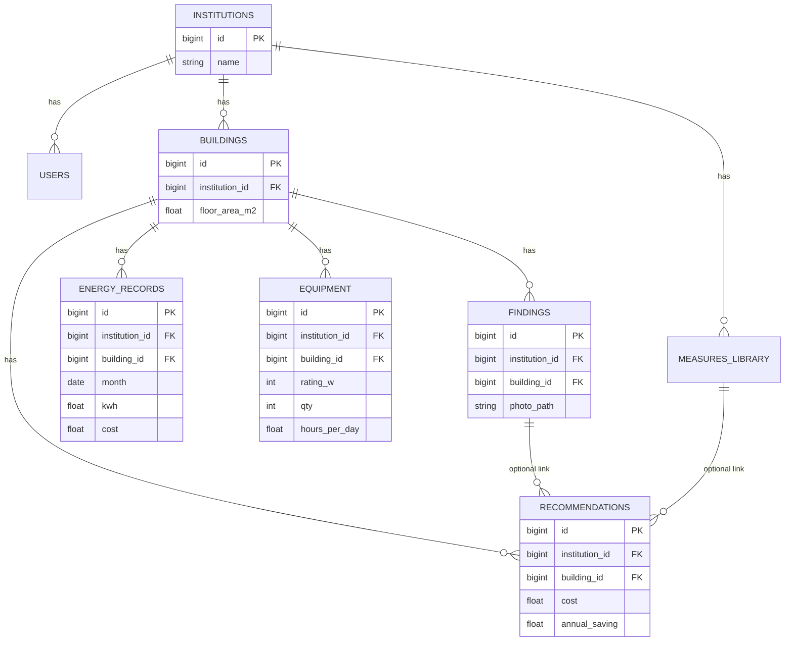

# Energy Audit (multi-institution)

A decision-support prototype for auditors at different institutions (colleges, schools, hospitals, offices).
Workflow: register institution → buildings → monthly energy data → analysis (EUI, charts, anomalies) →
equipment inventory and reconciliation → audit findings → recommendations with simple payback → PDF report.

- **Front end:** React (Vite), React Router, Chart.js, plain CSS with variables (`client/`)
- **Back end:** Node.js, Express, PostgreSQL (`pg`), Zod, bcrypt, JWT in an httpOnly cookie, multer, Puppeteer (`server/`)
- **Multi-tenant:** all institutions share one database; PostgreSQL row-level security keeps each one's data private.

This README covers **local setup only** (no deployment).

## Requirements

- Node.js 18 or newer
- A local PostgreSQL server (12+) and a superuser such as `postgres`

## Setup (a few commands)

```bash
# 1. Create the databases (use your own superuser / password if different)
createdb -U postgres energy_audit
createdb -U postgres energy_audit_test        # only needed for `npm test`

# 2. Configure the server
cp server/.env.example server/.env            # then edit JWT_SECRET and, if needed, the postgres password in OWNER_DATABASE_URL

# 3. Install, migrate, seed
npm install                                   # root: installs "concurrently"
npm run install:all                           # installs server/ and client/
npm run migrate                               # creates tables, RLS policies, login/sign-up functions and the app role
npm run seed                                  # 8 system measures + 2 fictional demo institutions

# 4. Run both apps
npm run dev                                   # API on http://localhost:4000, app on http://localhost:5173
```

Open **http://localhost:5173**.


## How information moves through the platform.

### 1. High-level system flow



---

### 2. Server request pipeline



---

### 3. Multi-tenant security flow



---

### 4. Core data processing (energy analysis)



---

### 5. Frontend data flow



---

### 6. Data model relationships



---

These cover the main information paths:

1. **System** — client → server → database  
2. **Request pipeline** — auth → tenant context → validation → service → repository  
3. **Tenant isolation** — JWT → `app.institution_id` → RLS  
4. **Analysis** — raw inputs → pure calculation functions → dashboard/reports  
5. **Frontend** — pages → hooks → api layer  
6. **Data model** — entity relationships  


### Project Architecture

```
energy-audit/
├── package.json                          # root scripts only (dev, test, migrate, seed, install:all)
├── README.md
│
├── client/                               # FRONTEND — React + Vite
│   ├── package.json
│   ├── vite.config.js                    # dev proxy: /api → http://localhost:4000
│   └── src/
│       ├── main.jsx                      # entry point
│       ├── App.jsx                       # providers + route table
│       ├── routes/
│       │   ├── ProtectedRoute.jsx        # requires login
│       │   └── RoleRoute.jsx             # admin only
│       ├── context/
│       │   └── AuthContext.jsx           # user, institution, role, login/logout
│       ├── api/                          # ONLY place that calls fetch
│       │   ├── client.js
│       │   └── …                         # one file per resource
│       ├── hooks/
│       │   ├── useApi.js
│       │   ├── useAuth.js
│       │   ├── useBuildings.js
│       │   └── useForm.js
│       ├── pages/                        # one file per screen
│       │   ├── Dashboard.jsx
│       │   ├── Buildings.jsx
│       │   ├── EnergyRecords.jsx
│       │   ├── Equipment.jsx
│       │   ├── Audit.jsx
│       │   ├── Recommendations.jsx
│       │   ├── Reports.jsx
│       │   ├── Users.jsx
│       │   ├── Settings.jsx
│       │   ├── Login.jsx
│       │   └── Register.jsx
│       ├── components/
│       │   ├── layout/
│       │   │   ├── AppLayout.jsx
│       │   │   ├── TopBar.jsx
│       │   │   └── SideNav.jsx           # role-aware
│       │   ├── ui/
│       │   │   ├── Button.jsx
│       │   │   ├── FormField.jsx
│       │   │   ├── DataTable.jsx
│       │   │   ├── StatusChip.jsx
│       │   │   ├── Alert.jsx
│       │   │   ├── ConfirmDialog.jsx
│       │   │   ├── Spinner.jsx
│       │   │   └── EmptyState.jsx
│       │   ├── charts/                   # Chart.js wrappers
│       │   │   ├── MonthlyChart.jsx
│       │   │   ├── EuiComparison.jsx
│       │   │   ├── EndUseChart.jsx
│       │   │   └── TrendChart.jsx
│       │   └── domain/
│       │       ├── BuildingSelector.jsx
│       │       ├── CsvImportPanel.jsx
│       │       ├── ReconciliationPanel.jsx
│       │       ├── AnomalyBanner.jsx
│       │       ├── FindingForm.jsx
│       │       ├── RecommendationCard.jsx
│       │       └── ReportPreview.jsx
│       ├── utils/
│       │   ├── csvParser.js
│       │   ├── formatters.js
│       │   └── validators.js             # mirror server rules
│       └── styles/
│           ├── tokens.css                # all colours / spacing
│           ├── base.css
│           ├── layout.css
│           └── components.css
│
└── server/                               # BACKEND — Node + Express + PostgreSQL
    ├── package.json
    ├── src/
    │   ├── server.js                     # start the HTTP server
    │   ├── app.js                        # Express setup
    │   ├── config/
    │   │   └── env.js                    # load + validate environment variables
    │   ├── db/
    │   │   ├── pool.js                   # pg Pool (non-superuser app role)
    │   │   ├── withTenant.js             # BEGIN → set_config → fn(client) → COMMIT
    │   │   ├── migrations/               # 001–008 plain SQL
    │   │   │   └── …                     # tables, RLS policies, SECURITY DEFINER auth fns
    │   │   └── seed/                     # system measures + two demo institutions
    │   ├── middleware/
    │   │   ├── requireAuth.js
    │   │   ├── requireRole.js
    │   │   ├── tenantContext.js
    │   │   ├── validate.js
    │   │   ├── upload.js
    │   │   ├── rateLimit.js
    │   │   ├── errorHandler.js
    │   │   └── notFound.js
    │   ├── routes/                       # HTTP only: parse → service → respond
    │   ├── validators/                   # Zod schemas
    │   ├── services/                     # business logic (pure functions for analysis)
    │   ├── repositories/                 # ONLY place with SQL (tenant-scoped client)
    │   ├── utils/
    │   │   ├── errors.js
    │   │   ├── asyncHandler.js
    │   │   ├── csv.js
    │   │   └── dates.js
    │   └── templates/
    │       ├── report.html
    │       └── report.css                # rendered to PDF by Puppeteer
    ├── uploads/
    │   └── <institution_id>/             # finding photos + generated reports
    └── tests/
        ├── unit/
        ├── api/
        ├── isolation/
        └── helpers/
        ```

### Demo logins (after `npm run seed`)

Password for every demo account: **`Demo1234!`** (also printed by the seed script).

| Institution | Admin | Auditor |
|---|---|---|
| Greenfield Technical College | admin@greenfield.example | auditor@greenfield.example |
| Lakeview Community Hospital | admin@lakeview.example | auditor@lakeview.example |

Or click **Register here** on the login page to create a brand-new institution.

## Tests

```bash
npm test      # runs server tests (Vitest + Supertest) against energy_audit_test
```

- `tests/unit` – EUI, annual totals, equipment kWh, reconciliation gap, anomaly flag, payback (incl. zero cases), CSV
- `tests/api` – validation (negative kWh, duplicate month, building limit, bad CSV rows), roles, no access without login, full workflow
- `tests/isolation` – two institutions cannot list/read/edit/delete each other's data; a raw SQL query without `app.institution_id` returns zero rows

## Project layout

```
energy-audit/
  package.json     root scripts only: dev, test, migrate, seed
  client/          React app (pages, components, api/ = the only place that calls fetch)
  server/          Express API: routes → services → repositories (all SQL), db/ (migrations, RLS, withTenant, seed)
```

## How tenancy works

- The institution id is read **only from the JWT**, never from the URL or body.
- `tenantContext` opens a transaction, runs `set_config('app.institution_id', …, true)` and exposes it as `req.db`.
- Every tenant table has `ENABLE` + `FORCE ROW LEVEL SECURITY`; the API connects as the non-superuser role `energy_app`
  (no `BYPASSRLS`). Login and sign-up (no tenant yet) use `SECURITY DEFINER` SQL functions.
- Another institution's record returns **404**, as if it did not exist.

## Roles

- **Admin:** everything an auditor can do, plus users, institution settings (name, currency, building limit) and deleting data.
- **Auditor:** create and edit buildings, records, equipment, findings, recommendations and reports.
- Admins create auditors with a temporary password (shown once); the auditor must change it at first login. No e-mail is sent.

## Assumptions and simple choices

- **Deleting data is admin-only** (the brief says admins "delete data"); auditors add and edit.
- **12-month window:** annual totals and EUI use the 12 calendar months ending at the building's latest record; EUI is shown only when all 12 exist, otherwise "incomplete".
- **Anomaly rule:** a month more than 30% above the average of the building's *other* months (`ANOMALY_THRESHOLD` in `.env`).
- **Saving estimate from a library measure** = typical saving % × the baseline cost. The baseline is the building's annual cost × the end-use share of the measure's category when an equipment inventory exists, otherwise the whole-building annual cost. Always editable and always labelled *estimate*.
- **Payback:** saving 0 → "Not applicable"; cost 0 (with a saving) → "Immediate".
- **Login rate limit:** `LOGIN_RATE_MAX` attempts per window per IP (in memory, single process).
- **Finding photos:** JPG/PNG up to 5 MB, random file name, stored under `server/uploads/<institution_id>/`, served only through an authenticated, tenant-scoped route.
- **PDF export** uses Puppeteer (downloads Chromium on `npm install`). If it cannot run on your machine, the Reports page also has **Print** → "Save as PDF" using the same report.
- **Export** (`GET /api/export?format=json|csv`) returns the institution's own data only.
- Out of scope, not built: meter/utility integrations, NPV/IRR, carbon, weather normalisation, verified savings, AI predictions, campus hierarchies, approvals, e-mail, offline sync, solar, client portal.

## Troubleshooting

- `password authentication failed` during `npm run migrate`: fix the password in `OWNER_DATABASE_URL` (the superuser).
- `database "energy_audit" does not exist`: run the `createdb` commands above.
- Cookies/login fail behind HTTPS: set `COOKIE_SECURE=true` (leave `false` for plain local http).
