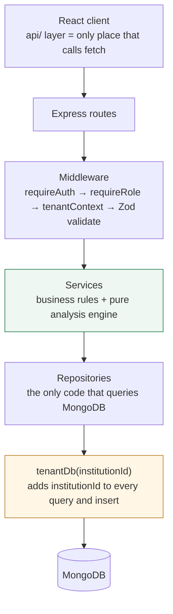
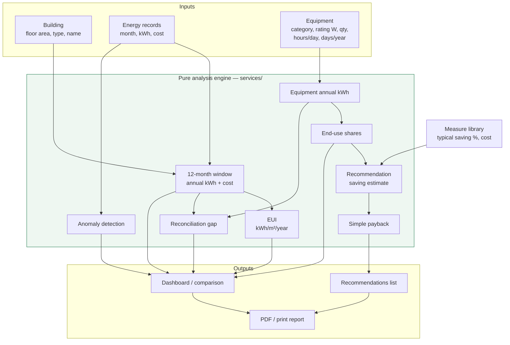
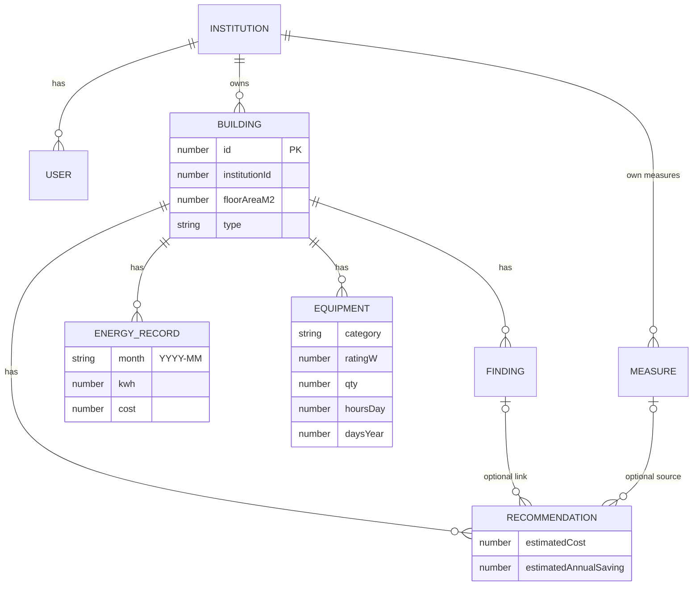
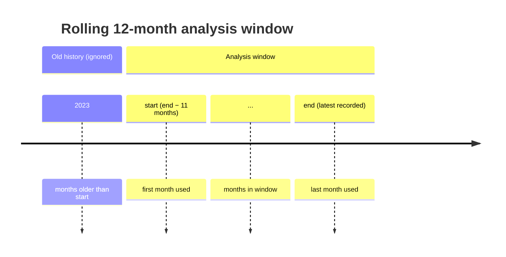
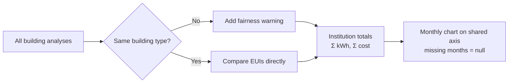
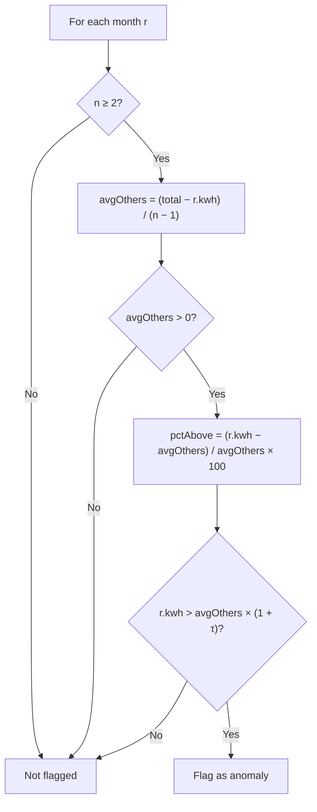
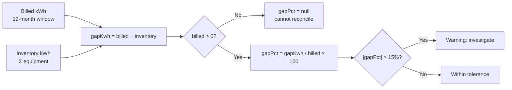
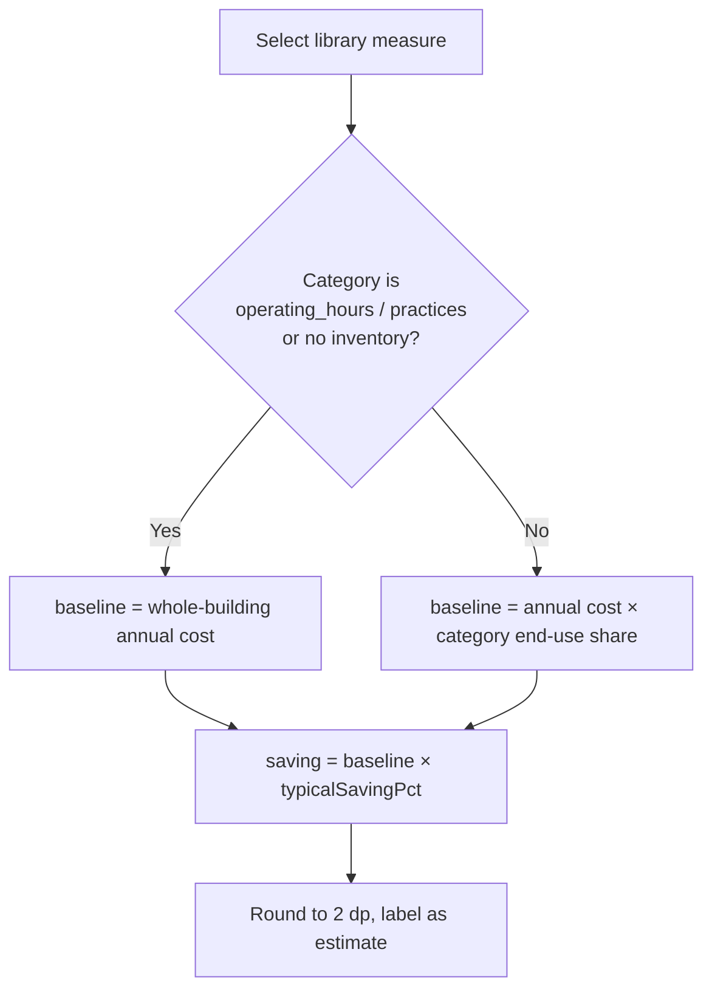
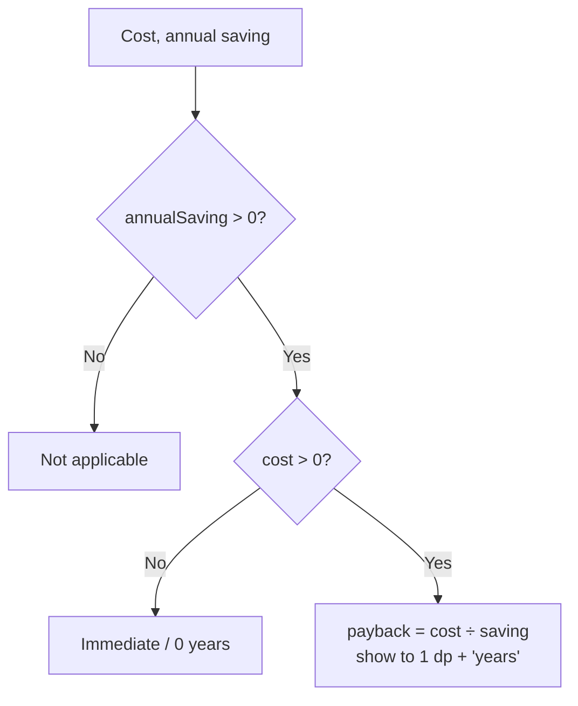

# Wattcheck — Energy Analysis Engine

Wattcheck is a multi-institution energy-audit decision-support tool for schools, colleges, hospitals and offices. This document describes the **analysis engine** in detail — every metric it computes and the exact formula behind it — followed by a summary of the app's features, how data is stored and isolated, and how to run it.

**Stack:** React (Vite) + Chart.js on the front end; Node.js, Express and **MongoDB** (official `mongodb` driver) on the back end, with Zod validation, bcrypt, JWT in an httpOnly cookie, multer and Puppeteer.

The engine is implemented as **pure functions** in `server/src/services/` (no database access, no I/O). Plain data in, plain data out, which keeps it easy to test and reason about.

| File | Responsibility |
|---|---|
| `analysis.service.js` | 12-month window, annual totals, EUI, cross-building comparison |
| `anomaly.service.js` | Flags months that are unusually high |
| `reconciliation.service.js` | Equipment annual kWh, end-use shares, inventory-vs-billed gap |
| `payback.service.js` | Recommendation saving estimate and simple payback |

---

## Architecture at a glance

The server is layered. A request only ever moves downward, and **only repositories touch MongoDB**.



---

## Engine data flow



---

## 1. Inputs

The engine works from three kinds of input per building:

| Input | Fields used |
|---|---|
| **Building** | `floorAreaM2` (m²), `type`, `name` |
| **Energy records** | `month` (`YYYY-MM`), `kwh`, `cost` — one row per calendar month |
| **Equipment** | `category`, `ratingW`, `qty`, `hoursDay`, `daysYear` |

An institution can record up to **100 buildings by default** (an admin can raise the limit to 1000 in Settings), and each building can have any number of equipment lines.



Every document carries an `institutionId` (except the institution itself); system measure presets have `institutionId: null`.

---

## 2. Analysis window and annual totals

Annual figures are **not** a raw sum of every record ever entered. They use a rolling **12-month window** that ends at the building's most recent recorded month.



Given the sorted records, let `end` be the latest recorded month:

$$
\text{start} = \text{end} - 11\ \text{months}, \qquad
W = \{\, r : \text{start} \le r.\text{month} \le \text{end} \,\}
$$

- `monthsInPeriod` = number of records inside the window (max 12).
- The window is **complete** when `monthsInPeriod = 12`.

Annual totals are summed over the window only:

$$
\text{annualKwh} = \sum_{r \in W} r.\text{kwh}
\qquad
\text{annualCost} = \sum_{r \in W} r.\text{cost}
$$

**Average cost per kWh:**

$$
\text{costPerKwh} =
\begin{cases}
\dfrac{\text{annualCost}}{\text{annualKwh}}, & \text{annualKwh} > 0 \\
\text{null}, & \text{otherwise}
\end{cases}
$$

> Rationale: a rolling window keeps figures current and comparable between buildings, and ignores stale records older than a year.

---

## 3. Energy Use Intensity (EUI)

EUI normalises consumption by floor area so buildings of different sizes can be compared.

$$
\text{EUI} = \frac{\text{annualKwh}}{\text{floorAreaM2}}
\quad \left[\mathrm{kWh\,/\,m^2\,/\,year}\right]
$$

Rules:

- If `floorAreaM2 ≤ 0`, EUI is `null` (unavailable).
- EUI is reported **only when the 12-month window is complete**. Otherwise the value is `null` and the label reads `incomplete (n of 12 months recorded)`.
- The engine never shows a partial-year EUI, because it would understate real intensity.

**Cross-building comparison** (`compareBuildings`):

- Each building contributes its EUI and annual kWh/cost.
- If the buildings have **different types** (case-insensitive), a warning is added noting that comparing their EUI may not be fair.
- Institution totals are the plain sums across buildings:

$$
\text{totalKwh} = \sum_{b} \text{annualKwh}_b
\qquad
\text{totalCost} = \sum_{b} \text{annualCost}_b
$$

- The monthly chart series puts every building on a shared month axis (the last 12 months any building has data for); missing months are `null`. With more than 8 buildings the dashboard's monthly chart shows the combined total instead of one bar per building.



---

## 4. Anomaly detection

A month is flagged when its consumption is more than a threshold **above the average of the building's other months** (excluding the month being tested).



For each record `r` where there are at least two records:

$$
\text{avgOthers}_r = \frac{\displaystyle\sum_i \text{kwh}_i - \text{kwh}_r}{n - 1}
$$

$$
\text{pctAbove}_r = \frac{\text{kwh}_r - \text{avgOthers}_r}{\text{avgOthers}_r} \times 100
$$

$$
\text{anomaly}_r \Longleftrightarrow \text{kwh}_r > \text{avgOthers}_r \,(1 + \tau)
$$

- Default `τ = 0.30` (30%), configurable via `ANOMALY_THRESHOLD` in `server/.env`.
- If `n < 2`, or `avgOthers ≤ 0` (no positive baseline), nothing is flagged.
- `pctAbove` is the percentage by which the month exceeds the others' average; it is reported with each flag.

> Rationale: comparing each month against the *other* months (rather than the mean of all months) prevents a single spike from hiding itself by inflating its own baseline.

---

## 5. Equipment annual consumption

For each equipment line, annual consumption is derived from its rating, quantity, daily usage and annual operating days:

$$
E_e = \frac{\text{ratingW}_e \times \text{qty}_e \times \text{hoursDay}_e \times \text{daysYear}_e}{1000}
\quad \left[\mathrm{kWh\,/\,year}\right]
$$

The `/1000` converts watts to kilowatts. Validation bounds: `ratingW > 0`, `qty ≥ 1` (whole), `0 ≤ hoursDay ≤ 24`, `0 ≤ daysYear ≤ 366` (whole). There is no cap on the number of equipment lines per building.

**Equipment categories (15):** `lighting`, `ac_ventilation`, `motors_pumps`, `ict`, `refrigeration`, `water_heating`, `kitchen_catering`, `office_equipment`, `medical_lab`, `laundry`, `lifts`, `audio_visual`, `workshop`, `security`, `other`.

The *Add equipment* form includes a **"Start from common equipment"** picker (about 100 items with indicative wattages). It only pre-fills the form; every value stays editable.

**End-use shares** — equipment is grouped by category, then:

$$
\text{categoryKwh}_c = \sum_{e \in c} E_e
\qquad
\text{totalKwh} = \sum_{c} \text{categoryKwh}_c
$$

$$
\text{sharePct}_c =
\begin{cases}
\dfrac{\text{categoryKwh}_c}{\text{totalKwh}} \times 100, & \text{totalKwh} > 0 \\
0, & \text{otherwise}
\end{cases}
$$

Categories with no equipment do not appear. Each equipment line also gets its own `sharePct = E_e / totalKwh × 100`.

---

## 6. Reconciliation (billed vs. inventory)

Reconciliation compares **billed consumption** (the 12-month window total) against the **inventory's calculated consumption**:



$$
\text{gapKwh} = \text{billedKwh} - \text{inventoryKwh}
$$

$$
\text{gapPct} =
\begin{cases}
\dfrac{\text{gapKwh}}{\text{billedKwh}} \times 100, & \text{billedKwh} > 0 \\
\text{null}, & \text{otherwise}
\end{cases}
$$

$$
\text{warning} \Longleftrightarrow |\text{gapPct}| > 15
$$

- `WARN_PCT = 15%`. A normal inventory covers only the audited equipment, so a modest gap is expected.
- If no billed consumption exists (`billedKwh = 0`), `gapPct` is `null` and the inventory cannot be reconciled.
- `billedComplete` carries the 12-month completeness flag from the analysis so the UI can caveat partial data.
- The message text changes with the outcome (no data / within tolerance / outside tolerance), always showing the gap to one decimal place.

---

## 7. Recommendation saving estimate

When a recommendation is pre-filled from a measure in the library, the estimated annual saving is:

$$
\text{baselineCost} =
\begin{cases}
\text{annualCost}, & \text{whole-building} \\
\text{annualCost} \times \dfrac{\text{endUseSharePct}}{100}, & \text{otherwise}
\end{cases}
$$

$$
\text{estimatedAnnualSaving} =
\mathrm{round}\left(\text{baselineCost} \times \frac{\text{typicalSavingPct}}{100},\ 2\right)
$$

Where:

- `annualCost` is the building's 12-month window cost.
- `endUseSharePct` is the measure category's share of **inventory** consumption (Section 5).
- `wholeBuilding` is **true** when the measure category is `operating_hours` or `practices`, **or** when no equipment inventory exists for that category (`endUseSharePct = null`).

A measure's category can be any of the 15 equipment categories, plus `operating_hours` and `practices`. `typicalSavingPct` and `typicalCost` come from the measure library. The suggested title is the measure name. Every pre-filled value is **editable** before saving and is always labelled an *estimate* (the app never stores a recommendation as anything other than an estimate).



**Built-in measures** (`npm run seed`):

| Measure | Category | Typical saving | Typical cost |
|---|---|---|---|
| LED lighting retrofit | lighting | 50% | 250,000 |
| Occupancy sensors | lighting | 25% | 80,000 |
| Efficient AC units | ac_ventilation | 30% | 600,000 |
| AC schedule / switch-off | ac_ventilation | 15% | 20,000 |
| VFD on pumps | motors_pumps | 30% | 350,000 |
| Power factor correction | other | 5% | 300,000 |
| Timer on water heating | other | 20% | 25,000 |
| Staff awareness programme | practices | 5% | 15,000 |

Institutions can add their own measures; these are visible only to that institution.

---

## 8. Simple payback

Simple payback is the number of years for the estimated annual saving to repay the estimated cost:

$$
\text{paybackYears} = \frac{\text{estimatedCost}}{\text{estimatedAnnualSaving}}
$$



Zero-handling, in this order:

| Condition | Result |
|---|---|
| `annualSaving ≤ 0` | `Not applicable` (no saving to repay anything) |
| `annualSaving > 0` and `cost ≤ 0` | `Immediate` (0 years) |
| `annualSaving > 0` and `cost > 0` | `cost / saving`, shown to 1 decimal place + "years" |

> Rationale: check the saving first, so a zero saving always reads "Not applicable" even if the cost is also zero.

---

## 9. Worked example

A building with a 1,800 m² floor area and a complete 12-month window:

- `annualKwh = 252,000`, `annualCost = 6,048,000`
- EUI: $\;252{,}000 / 1{,}800 = 140.0\ \mathrm{kWh/m^2/year}$
- Cost per kWh: $\;6{,}048{,}000 / 252{,}000 = 24.00$
- Its lighting inventory totals `60,000 kWh`; total inventory `120,000 kWh` → $\;\text{lighting share} = 50\%$
- **LED retrofit** (50% typical saving), inventory exists:
  - $\text{baselineCost} = 6{,}048{,}000 \times 0.50 = 3{,}024{,}000$
  - $\text{estimatedAnnualSaving} = 3{,}024{,}000 \times 0.50 = 1{,}512{,}000$
  - $\text{payback} = 250{,}000 / 1{,}512{,}000 \approx 0.2\ \text{years}$
- **Reconciliation**: billed `252,000` vs. inventory `120,000` →
  $\;\text{gapPct} = (252{,}000 - 120{,}000)/252{,}000 \times 100 \approx 52.4\%$ → warning (inventory covers only part of the building).

---

## 10. Model assumptions and limits

- All annual figures use the rolling 12-month window, not the calendar year or the full history.
- EUI is hidden until all 12 months are present.
- Anomaly detection is a simple relative-to-other-months rule; it does not model weather or occupancy.
- Savings and paybacks are **estimates**, never verified measured savings.
- The engine does no weather normalisation, NPV/IRR, carbon accounting or forecasting.

---

## App features

**Multi-institution, multi-tenant**
- Each institution's data is isolated by a tenant-scoped database handle (see [Data storage and tenant isolation](#data-storage-and-tenant-isolation)); another institution's record behaves as if it does not exist (**404**).
- Roles: **Admin** (full access plus users, institution settings — name, currency, building limit — and deletion) and **Auditor** (create/edit audit data). New auditors get a one-time temporary password and must change it at first login. No e-mail is sent.

**Audit workflow**
- **Buildings** — register buildings with type, floor area and operating hours (100 per institution by default, up to 1000).
- **Energy records** — enter monthly kWh and cost manually or import from CSV (`month,kwh,cost`) with per-row validation and duplicate-month checks. Imports are dry-run first and only write valid rows on confirm.
- **Dashboard** — institution-wide overview: annual consumption/cost, EUI per building, monthly trend chart, EUI comparison and flagged anomalies.
- **Equipment inventory** — per-building equipment lines across 15 categories, a common-equipment picker, and automatic annual kWh and end-use share calculations.
- **Reconciliation** — billed vs. inventory comparison with a 15% tolerance warning.
- **Audit findings** — record findings by area (lighting, AC & ventilation, motors & pumps, operating hours, practices) with priority and an optional JPG/PNG photo (up to 5 MB).
- **Recommendations** — pre-fill from a measure library, then edit cost/saving; automatic simple payback. Library includes system measures plus institution-specific ones.
- **Reports** — per-building audit report with KPIs, energy summary table, EUI, monthly chart (anomalies highlighted), findings, recommendations and an editable conclusion. Export to PDF (Puppeteer) or print to PDF.
- **Data export** — download the institution's own data as JSON or CSV.

**Charts and data**
- Monthly consumption, trend, EUI comparison and end-use breakdown charts (Chart.js), each with an accessible data-table alternative.

**Security and operations**
- JWT in an httpOnly cookie; tenant id taken only from the token, never from the URL or body.
- Login rate limiting, Zod validation on every input, tenant-scoped file storage for finding photos (`server/uploads/<institutionId>/`, served only through an authenticated route).
- Seeded demo institutions and a Vitest/Supertest suite covering the formulas, validation, roles and cross-tenant isolation.

---

## Data storage and tenant isolation

Data lives in **MongoDB**. Collections are created automatically; the server creates its unique indexes at start-up.

| Collection | Notes |
|---|---|
| `institutions` | name (unique), currency, `maxBuildings` |
| `users` | e-mail (unique, stored lower-case), role, password hash, `mustChangePassword` |
| `buildings` | unique name per institution |
| `energy_records` | `month` stored as `YYYY-MM`; unique per building and month |
| `equipment`, `findings`, `recommendations` | each linked to a building |
| `measures_library` | system presets (`institutionId: null`) plus each institution's own measures |
| `counters` | auto-increment counters, so ids stay simple numbers |

**How tenants are kept apart** (MongoDB has no row-level security, so this is enforced in code):

- The institution id is read **only from the verified JWT**.
- `tenantContext` creates `req.db = tenantDb(institutionId)`. That handle adds the institution id to **every** query (last, so a caller cannot override it) and stamps it onto every insert.
- Only repositories use the handle, and routes → services → repositories is the only call path. System measure presets are readable by every institution but never writable.
- Login and sign-up (no tenant yet) use small dedicated repository functions.
- Without foreign keys, deleting a building also deletes its records, equipment, findings and recommendations in code; deleting a finding clears the link on recommendations that used it.
- Duplicate e-mails, institution names, building names and months are rejected by unique indexes and returned as friendly **409** messages.
- The building limit is checked just before insert (no row lock), so two simultaneous requests could, very rarely, exceed it by one.

`tests/isolation` checks that one institution cannot read, change or delete another's documents, even with a forged filter.

---

## Running the app

**Requirements:** Node.js 18+ and MongoDB 6+ (a local install on `mongodb://127.0.0.1:27017`, or a free MongoDB Atlas cluster). No replica set is needed.

```bash
cp server/.env.example server/.env   # set JWT_SECRET and, if needed, MONGODB_URI
npm install                          # root (concurrently)
npm run install:all                  # server + client
npm run db:setup                     # create indexes (the server also does this on start-up)
npm run seed                         # measure library + demo institutions
npm run dev                          # API :4000, app :5173
```

Open **http://localhost:5173** (not port 4000; `/api` alone is not a page).

Key `server/.env` settings:

| Variable | Purpose |
|---|---|
| `MONGODB_URI` | Local `mongodb://127.0.0.1:27017` or an Atlas `mongodb+srv://…` string (URL-encode special characters in the password) |
| `MONGODB_DB` | Database name, default `energy_audit` |
| `TEST_MONGODB_DB` | Separate database wiped by `npm test`; its name must end in `_test` |
| `JWT_SECRET` | At least 16 characters |
| `ANOMALY_THRESHOLD`, `LOGIN_RATE_MAX` | Business constants (defaults 0.30 and 10) |

**Demo logins** (after `npm run seed`; password for all: `Demo1234!`)

| Institution | Admin | Auditor |
|---|---|---|
| Greenfield Technical College | admin@greenfield.example | auditor@greenfield.example |
| Lakeview Community Hospital | admin@lakeview.example | auditor@lakeview.example |

Or use **Register here** on the login page to create a new institution.

**Tests:** `npm test` runs the server suite (Vitest + Supertest) against the separate test database.

**Troubleshooting**
- `bad auth : authentication failed` — wrong username/password in `MONGODB_URI` (for Atlas, use the *database user's* password).
- `Cannot connect to MongoDB` on start-up — start the MongoDB service, or check `MONGODB_URI` (Atlas also needs your IP in its network access list).
- Login works on `localhost` but cookies fail behind HTTPS — set `COOKIE_SECURE=true` (leave `false` for plain local http).

See `docs/README.md` for the full local setup notes.